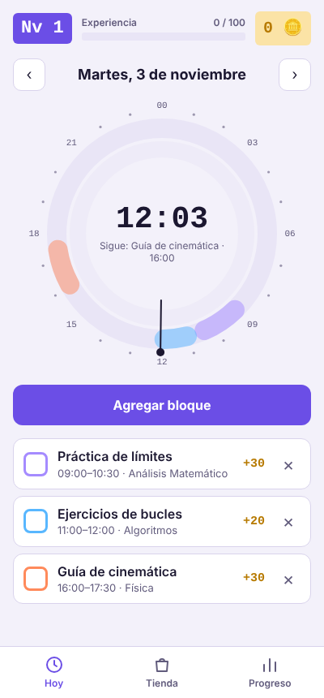
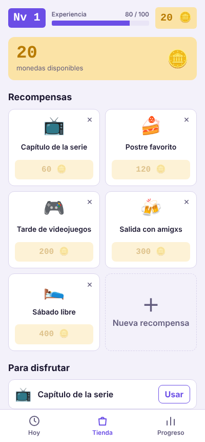
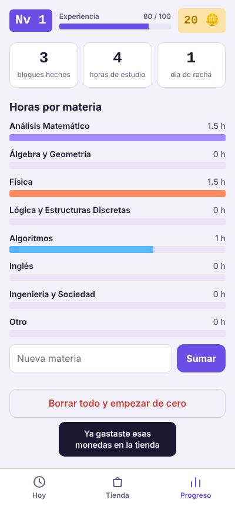

# Nivelá

Planificador de estudio que convierte cada bloque de trabajo en un juego: ves tu día en un **reloj de 24 horas**, ganás **experiencia y monedas** al terminar cada bloque y las canjeás por **recompensas que definís vos** (una serie, un postre, un sábado libre).

> **Estado:** proyecto personal. HTML, CSS y JavaScript sin librerías. La lógica tiene pruebas automáticas.

<p>



</p>

## El problema

Estudiar varias materias a la vez es difícil de organizar: las listas de tareas no muestran cuánto tiempo hay realmente en el día, y cuesta mantener la constancia cuando el resultado (el examen) queda lejos. Nivelá ataca las dos cosas: el reloj muestra el día completo de un vistazo y el sistema de niveles le da una recompensa inmediata a cada bloque terminado.

## Qué hace

- **Reloj de 24 horas.** Cada bloque es un arco coloreado según la materia. Una aguja marca la hora actual. Si dos bloques se pisan, el segundo pasa al anillo interno.
- **Bloques por día.** Se navega entre días, se agrega un bloque con materia, hora de inicio y duración, y se marca como hecho.
- **Experiencia y niveles.** Cada 3 minutos de un bloque terminado dan 1 XP (mínimo 5). Cada 100 XP se sube de nivel.
- **Monedas y tienda.** Las monedas ganadas se gastan en recompensas propias: se pueden crear y borrar. Lo canjeado queda en "Para disfrutar" hasta que se usa.
- **Progreso.** Bloques hechos, horas de estudio, días de racha y horas por materia. Se pueden sumar materias nuevas.
- **Accesible y adaptable.** Funciona en el celular, respeta el modo oscuro del dispositivo y el ajuste de "movimiento reducido", y los controles se pueden usar con teclado.
- Los datos se guardan en el navegador (no hay cuentas ni servidor).

## Reglas del juego

| Regla | Detalle |
|---|---|
| XP de un bloque | `duración en minutos ÷ 3`, redondeado, con mínimo de 5 |
| Moneda | Cada XP ganado es también una moneda |
| Nivel | `XP total ÷ 100`, más 1 |
| Racha | Días seguidos con al menos un bloque hecho. Si hoy todavía no hay ninguno, la racha no se corta: cuenta desde ayer |
| Deshacer un bloque | No se puede desmarcar ni borrar un bloque hecho si las monedas que dio ya se gastaron, para que el saldo nunca quede negativo |

## Decisiones técnicas

| Decisión | Motivo |
|---|---|
| Lógica pura separada de la interfaz (`logic.js`) | Se puede probar con Node, sin abrir un navegador |
| Reloj dibujado con SVG y arcos calculados | Es nítido en cualquier tamaño y cada bloque es un elemento clickeable y accesible |
| Geometría del reloj (`punto`, `arco`, `carriles`) como funciones probadas | Los errores de ángulos son fáciles de cometer y difíciles de ver |
| `localStorage` con manejo de errores | La app sigue funcionando en memoria si el navegador no permite guardar |
| Contenido del usuario escapado antes de dibujarlo | Un título con HTML no puede romper la página |

## Pruebas

```
node test.js
```

25 pruebas sin dependencias: XP y niveles, monedas, la regla de no gastar monedas dos veces, racha (incluido el cambio de mes), minutos por materia, geometría del reloj, superposición de bloques y datos iniciales.

## Archivos

```
index.html   estructura de la página
styles.css   estilos (claro y oscuro)
logic.js     reglas del juego y geometría, sin DOM
app.js       interfaz: dibuja, escucha clics y guarda
test.js      pruebas
captura-*.png  imágenes de este README
```

`Nivela-un-solo-archivo.html` es la misma app en un único archivo, por si se prefiere abrir sin más.

## Cómo usarlo

**En tu computadora:** abrí `index.html` con el navegador, con todos los archivos en la misma carpeta.

**Publicado con GitHub Pages:** subí los archivos, andá a **Settings → Pages**, elegí la rama `main` y `/ (root)`, y en un minuto queda en `https://TU-USUARIO.github.io/nivela/`.

## Cómo se desarrolló

La idea y las reglas del juego son mías, pensadas para organizar mi cursada de Ingeniería en Sistemas. La desarrollé con Claude como asistente de programación: yo definí qué debía hacer y cómo debía verse, y revisé y probé el resultado.

## Limitaciones y próximos pasos

- Los datos viven en un solo navegador: no hay sincronización entre dispositivos.
- Los bloques no se repiten (no hay bloques semanales fijos).
- Las fuentes se cargan desde Google Fonts; sin conexión se usan fuentes del sistema.
- Sumar una vista semanal y la posibilidad de editar un bloque ya creado.
